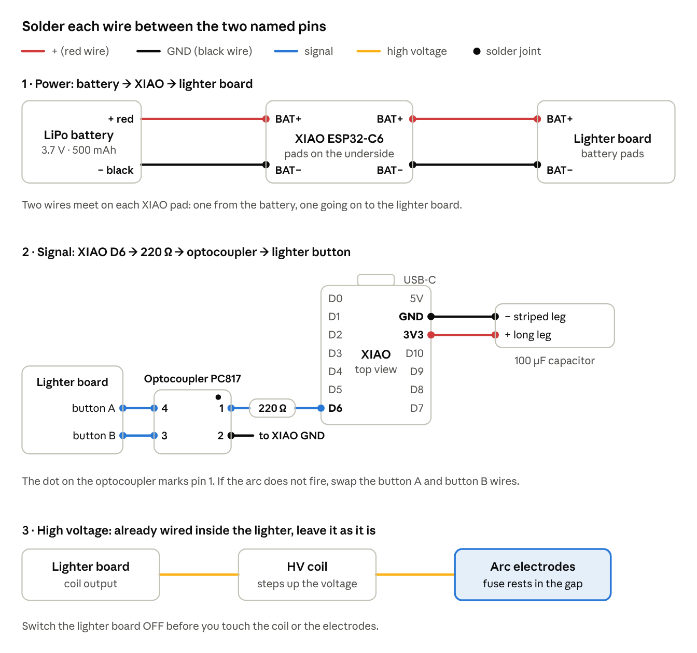
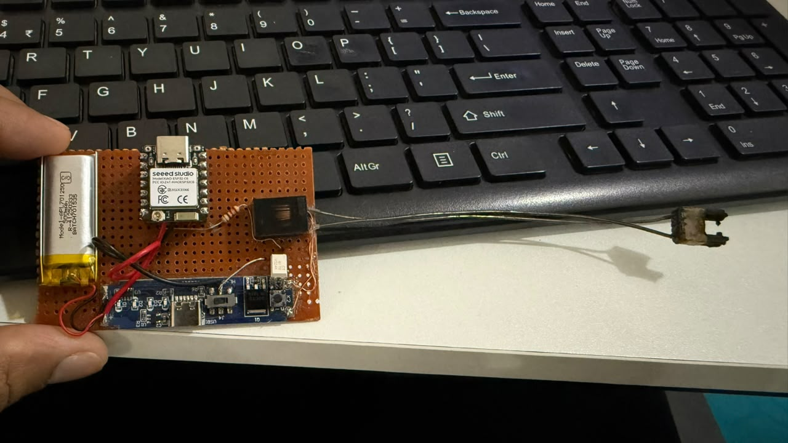

# Focus Patakha – XIAO ESP32-C6 Igniter (Client)

The **igniter side** of Focus Patakha: light a Diwali patakha just by concentrating. This firmware runs on a **Seeed Studio XIAO ESP32-C6**. It joins the NPG Lite's Wi-Fi hotspot, receives fire/stop messages, and triggers an electric arc lighter through an optocoupler.

The NPG Lite does all the thinking (EEG, focus score, dashboard); the XIAO only obeys and reports back. For the brain side, see [BCI-Focus-Patakha-Remote](../BCI-Focus-Patakha-Remote/README.md).

---

## How It Works

- It joins the NPG Lite's hotspot **`NPG-Focus-Light`** (password **`12345678`**) and listens on **UDP port 4210**.
- Every 100 ms the NPG Lite sends a tiny message such as `F,14.20,1`: focus %, then `1` = fire or `0` = stop.
- On `1` the XIAO drives **D6 (GPIO16)** high. Current flows through the 220 Ω resistor into the optocoupler LED, the optocoupler's output closes the lighter's button contacts, and the arc fires.
- It replies `A,1` or `A,0` to **UDP port 4211**, so the dashboard shows what the igniter is really doing, not just what was asked.
- **Fail-safe:** if no message arrives for 1.5 s (NPG Lite off, out of range, Wi-Fi drop), the XIAO switches the output off by itself.
- The XIAO's small orange LED blinks fast while it searches for the hotspot and stays on while the igniter is firing.

The sketch also switches the XIAO's antenna selector to the built-in ceramic antenna (GPIO3 and GPIO14), so no external antenna is needed.

---

## Hardware Requirements

- **Seeed Studio XIAO ESP32-C6**
- **Optocoupler, 4-pin** (for example PC817)
- **220 Ω resistor** (current limit for the optocoupler LED)
- **100 µF electrolytic capacitor** (across the XIAO's 3.3 V and GND)
- **Rechargeable electric arc lighter** (we use its driver board, high-voltage coil and arc electrodes)
- **3.7 V 500 mAh LiPo battery** (powers both the XIAO and the lighter)
- **Perfboard, hook-up wire, heat-shrink**
- **Soldering iron and solder**
- **Legal, store-bought crackers** with a fuse (anaar, phuljhadi, chakri and so on)
- **A bucket of water or sand**

---

## Software Requirements

- **Arduino IDE 2.x**
- **Espressif ESP32 board package 3.x** (tested with 3.1.1 and 3.2.0). Version 2.x does not support the ESP32-C6.
- No extra libraries needed (uses the built-in `WiFi` and `WiFiUdp`)
- This firmware file: `BCI-Focus-Patakha-Client.ino`

See [BCI-Focus-Patakha-Remote](../BCI-Focus-Patakha-Remote/README.md#arduino-ide-setup) for the board package setup.

---

## Build the Igniter Board

The XIAO never touches the lighter's high voltage. It only lights the LED inside an optocoupler, and the optocoupler's output acts as the lighter's fire button.

1. **Open the electric lighter.** Take out its driver board, the high-voltage coil and the two arc electrodes. Keep the board's slide switch: it becomes your **arming switch**.
2. **Find the fire button.** Locate the two pads of the lighter's push button on the driver board. Pressing it makes an arc; this is what the optocoupler will press for you.
3. **Solder the parts onto the perfboard** and wire them like this:

| From | To | Why |
|------|----|-----|
| XIAO D6 (GPIO16) | 220 Ω resistor | Limits current into the optocoupler LED |
| 220 Ω resistor | Optocoupler pin 1 (anode) | XIAO turns the LED on |
| Optocoupler pin 2 (cathode) | XIAO GND | LED return |
| Optocoupler pin 4 (collector) | Fire-button pad, + side | Acts as the button |
| Optocoupler pin 3 (emitter) | Fire-button pad, − side | Acts as the button |
| LiPo + / − | Lighter driver board BAT + / − | Powers the arc |
| LiPo + / − | XIAO BAT+ / BAT− pads (underside) | Powers the XIAO |
| Driver board output | High-voltage coil → arc electrodes | Makes the spark |
| 100 µF capacitor + (long leg) / − (striped side) | XIAO 3V3 / XIAO GND | Holds the 3.3 V steady during power dips |

> **Why the 100 µF capacitor?** The XIAO and the lighter share one 500 mAh battery. When the arc fires it pulls a burst of current, and the battery voltage dips for a moment. Without the capacitor that dip can reset the XIAO, which then drops off Wi-Fi in the middle of a fire. The capacitor across 3V3 and GND holds the voltage up through the dip. Mind its polarity: the striped leg goes to GND.

4. **Check the button polarity.** If the arc does not fire later, swap the optocoupler's pin 3 and pin 4 wires: a transistor output only conducts one way.
5. **Route the electrode wires** without bending the electrode tips, so the lighter's original arc gap stays the same. Mount the electrodes where the cracker's fuse can rest in the gap.
6. **Insulate everything.** Keep the high-voltage coil and its wires away from the XIAO and the battery, and cover exposed joints with heat-shrink.

---

## Flashing the XIAO

Two ways to flash: the web flasher is quicker if you only want to run the firmware. Use the Arduino IDE if you plan to change it.

### Web Flasher

The same [NPG Lite Flasher Web](https://upsidedownlabs.github.io/NPG-Lite-Flasher-Web/) works for the XIAO, since both boards use the ESP32-C6. Use Chrome or Edge.

1. Connect the XIAO to your computer with a USB-C cable.
2. Press **Connect** and pick the **USB JTAG** serial device.
3. Press **Get from GitHub** and choose the **BCI-Focus-Patakha-Client** firmware.
4. Flash it. Once it finishes, press the XIAO's **RESET** button or replug the cable.

> If the XIAO does not show up, hold its **BOOT** button while plugging in the cable, then try **Connect** again.

### Arduino IDE

1. Open `BCI-Focus-Patakha-Client.ino`.
2. Plug in the XIAO and select **Tools → Board → XIAO_ESP32C6** and its port.
3. Click **Upload**, then open the Serial Monitor at **115200 baud**.
4. Power on the NPG Lite. The XIAO prints `Connected! XIAO IP: 192.168.4.x`.

### Settings

Change these at the top of `BCI-Focus-Patakha-Client.ino`:

| Setting           | Default | What it does |
|-------------------|---------|--------------|
| `LED_PIN`         | `16`    | Output pin driving the optocoupler (D6) |
| `LINK_TIMEOUT_MS` | `1500`  | Fail-safe: output turns off if no message arrives for this long |
| `AP_SSID` / `AP_PASS` | `NPG-Focus-Light` / `12345678` | Must match the NPG Lite firmware |

---

## Light a Real Patakha

1. Place the cracker on flat, open ground **outdoors**.
2. Rest its fuse in the arc gap of the electrodes.
3. Move the slide switch on the lighter board to **ON (armed)**, then step back at least **3 m**.
4. Focus. When you cross the threshold on the NPG Lite dashboard, the arc lights the fuse.
5. **Disarm the slide switch** before you go near the igniter again.

Tip: use the dashboard's **Always lit** mode (with no cracker in place) to test the wiring, and **Off** to keep the igniter disarmed from the dashboard.

---

## Safety First

This project lights real fireworks. Treat the igniter like a lit match.

- **Adults only at the igniter**; kids can wear the headset and focus from a safe distance.
- **Outdoors, on open ground**, away from people, vehicles, dry leaves and anything that can burn.
- **Arm last, disarm first.** Keep the lighter board's slide switch OFF while you place the cracker, and switch it OFF again before you go back.
- **Stand at least 3 m away once armed.** The person wearing the NPG Lite stays with the laptop, not next to the cracker.
- **Never hold or lean over a lit or misfired cracker.** If it does not go off, disarm, wait at least 5 minutes, then soak it in water.
- **Keep water or sand nearby.**
- **Keep the arc away from your skin and the electronics.** The lighter makes several thousand volts at its tips.
- **The arc stays on while you stay focused.** Drop your focus (or press Off) as soon as the fuse catches, so the lighter and battery do not overheat.
- **Use only legal, store-bought crackers**, and follow your local rules on when and where they are allowed.
- The XIAO's 1.5 s fail-safe stops the igniter if Wi-Fi drops, but it is **not a substitute for the slide switch**.

---

## Troubleshooting

| Problem | Fix |
|---------|-----|
| Board XIAO_ESP32C6 not in the list | Install the ESP32 package version 3.x, not 2.x. |
| XIAO never prints `Connected!` | Power the XIAO after the NPG Lite, keep them within a few metres, and check the NPG Lite's Serial Monitor shows the hotspot is up. |
| Dashboard XIAO chip shows amber (fewer than 5 replies/s) | Weak Wi-Fi: bring the boards closer and keep the high-voltage coil away from the XIAO's antenna. |
| Dashboard says *Forced on* but nothing fires | Check the arming slide switch, then swap the optocoupler's pin 3 and pin 4 wires. |
| XIAO restarts or goes offline the moment the arc fires | Check the 100 µF capacitor across 3V3 and GND (striped leg to GND), charge the battery, and keep the high-voltage wires away from the XIAO. |

---

Built with ❤️ by Upside Down Labs. Happy Diwali!
