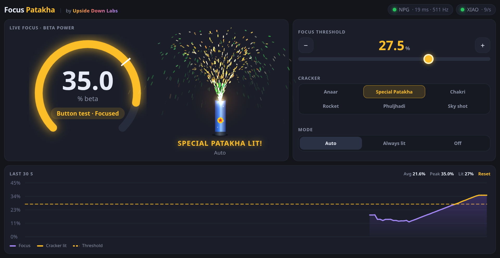
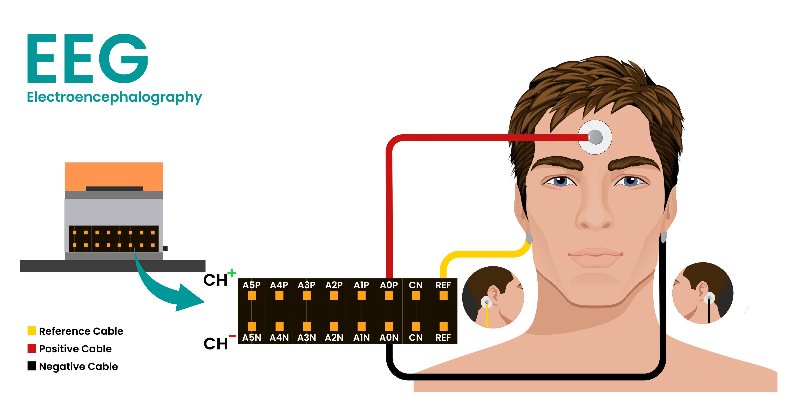

# Focus Patakha – NPG Lite (Remote / Controller)

Light a Diwali patakha just by concentrating! This firmware runs on the **Neuro PlayGround (NPG) Lite** by Upside Down Labs. It reads your brainwaves (EEG), calculates a focus score, hosts a live web dashboard and tells the igniter board when to fire. When your focus crosses a threshold you set, a real electric lighter fires and the cracker on screen bursts into sparks across the whole dashboard.

This is the **brain side** of the project. The igniter side runs on a Seeed Studio XIAO ESP32-C6: see [BCI-Focus-Patakha-Client](../BCI-Focus-Patakha-Client/README.md).

---

## How It Works

When you concentrate, the share of **beta waves (13–30 Hz)** in your EEG usually rises. The NPG Lite measures that share 4 times a second and treats it as your focus score.

Three parts work together:

- **NPG Lite on your head:** reads the EEG, calculates focus, hosts the web dashboard and decides when to fire.
- **Laptop:** shows the live focus gauge, the threshold slider, a 30-second graph and an animated cracker.
- **XIAO ESP32-C6 igniter board:** receives ON/OFF over Wi-Fi and triggers an electric arc lighter through an optocoupler.

No router or internet is needed. The NPG Lite creates its own Wi-Fi hotspot **`NPG-Focus-Light`** and everything connects to it. The laptop reads live data from it for the dashboard, while the XIAO gets a fire or stop message every 100 ms on a separate channel (UDP), so a slow browser never delays the igniter.

---

## Hardware Requirements

- **NPG Lite** by Upside Down Labs
- **3 snap cables + gel electrodes** (or BioAmp cables with alligator clips)
- **Nuprep skin-prep gel** and **alcohol wipes**
- **USB-C cable**
- **Laptop** (for flashing and the dashboard)
- **Igniter board** built as described in [BCI-Focus-Patakha-Client](../BCI-Focus-Patakha-Client/README.md)

---

## Software Requirements

- **Arduino IDE 2.x**
- **Espressif ESP32 board package 3.x** (tested with 3.1.1 and 3.2.0). Version 2.x does not support the ESP32-C6.
- Libraries:
  - `Adafruit NeoPixel`
  - `OneButton` (by Matthias Hertel)
  - `ESP-DSP` (FFT), already included in the ESP32 3.x package
- Firmware files (must sit in the same folder):
  - `BCI-Focus-Patakha-Remote.ino`: reads the EEG, calculates focus, talks to the XIAO and runs the web server
  - `index_html.h`: the whole dashboard (HTML, CSS and JavaScript). It is kept out of the `.ino` because the Arduino IDE's prototype generator breaks on JavaScript inside a sketch file.

### Arduino IDE Setup

1. Install Arduino IDE 2.x.
2. Open **File → Preferences** and add this URL to **Additional boards manager URLs**:
   `https://raw.githubusercontent.com/espressif/arduino-esp32/gh-pages/package_esp32_index.json`
3. Open **Tools → Board → Boards Manager**, search `esp32` and install **esp32 by Espressif Systems**, version 3.x.
4. Open **Sketch → Include Library → Manage Libraries**, install **Adafruit NeoPixel**, then **OneButton** (by Matthias Hertel).

---

## Flashing the NPG Lite

Two ways to flash: the web flasher is quicker if you only want to run the firmware. Use the Arduino IDE if you plan to change it.

### Web Flasher

Use the [NPG Lite Flasher Web](https://upsidedownlabs.github.io/NPG-Lite-Flasher-Web/) in Chrome or Edge.

1. Switch on the NPG Lite and connect it to your computer with a USB-C cable.
2. Press **Connect** and pick the **USB JTAG** serial device.
3. Press **Get from GitHub** and choose the **BCI-Focus-Patakha-Remote** firmware.
4. Flash it. Once it finishes, press the **RESET** button or replug the cable.

### Arduino IDE

1. Keep `BCI-Focus-Patakha-Remote.ino` and `index_html.h` together in the `BCI-Focus-Patakha-Remote` folder (the folder name must match the `.ino` name).
2. Open `BCI-Focus-Patakha-Remote.ino`. The page file shows up as a second tab.
3. Plug in the NPG Lite with a USB-C cable.
4. Select **Tools → Board → ESP32C6 Dev Module**, set **USB CDC On Boot → Enabled**, and pick the right port.
5. Click **Upload**.
6. Open the Serial Monitor at **115200 baud**. You should see `Hotspot "NPG-Focus-Light" up` and `Ready. Threshold 8.0%`.

### What the Firmware Does

It runs three jobs at different priorities, so a slow browser can never delay the EEG or the igniter:

| Job        | Priority | Work |
|------------|----------|------|
| Sampling   | Highest  | A hardware timer reads Channel 1 (A0) 512 times a second and filters it (50 Hz mains notch + low-pass). |
| Control    | Medium   | Every 0.25 s an FFT over the last 1 s gives beta (13–30 Hz) as a % of total power. It decides ON/OFF and messages the XIAO every 100 ms. |
| Web server | Lowest   | Serves the dashboard and live data to the laptop. |

The cracker turns **ON** when focus rises above the threshold, and **OFF** only when it falls 1% below it. That gap stops the lighter from flickering when your focus hovers right at the line. The threshold is saved in the NPG Lite's flash memory, so it survives a restart.

---

## Electrode Placement

Good skin contact is the difference between a clean focus signal and noise.

**Skin prep**
1. Rub a little Nuprep gel on each spot for a few seconds to remove dead skin.
2. Wipe the spot clean with an alcohol wipe and let it dry.

**Placement (Channel 1)**

| NPG Lite cable       | Where it goes |
|----------------------|---------------|
| A0P (Channel 1 +)    | Forehead, just above one eyebrow (prefrontal area, Fp1 or Fp2 in the 10–20 system) |
| A0N (Channel 1 −)    | Bony part behind one earlobe |
| REF                  | Bony part behind the other earlobe |

**Tips**
- Sit still and relax your face and jaw: blinks and jaw clenches show up as big spikes.
- Keep the NPG Lite on battery, not plugged into the laptop, for the cleanest signal.

---

## How to Use

### 1. Open the Dashboard

1. Switch on the NPG Lite and the igniter board.
2. On your laptop, join the Wi-Fi network **`NPG-Focus-Light`** (password **`12345678`**).
3. Open **http://focus-light.local** in a browser. If the page does not load, use **http://192.168.4.1** instead (some Windows laptops and most Android phones cannot open `.local` names).
4. Check the two status chips at the top right:
   - **NPG · 5 ms · 512 Hz:** the page is getting live data and the EEG is sampled at full speed.
   - **XIAO · 10/s:** the igniter is answering about 10 times a second. Red means offline; amber means a weak link.

### 2. Set Your Threshold

1. **Find your baseline.** Relax with your eyes open for about a minute and watch the focus gauge and the 30-second graph.
2. **Set the threshold** a few points above your relaxed value with the slider or the **+ / −** buttons. The white tick on the gauge and the dashed line on the graph show it. It saves automatically.
3. **Now concentrate:** count backwards from 100 in sevens, or solve sums in your head. When the gauge crosses the line it turns gold, and the igniter fires.

**Mode buttons:**
- **Auto:** fires on focus
- **Always lit:** forces it on (use it to test the wiring)
- **Off:** keeps the igniter disarmed from the dashboard

The NeoPixels on the NPG Lite also show your focus: 3 lit means you are at the threshold, all 6 means double, and all six turn bright white while it fires.

### 3. Pick Your Patakha

The dashboard has six animated crackers. Pick one under **Cracker**. When the igniter fires, it lights on screen and its sparks fly out over the whole page, land on the cards and light them up.

| Cracker         | What it does on screen |
|-----------------|------------------------|
| Anaar           | Gold fountain for about 4.5 s, then a final burst |
| Special Patakha | Green-and-gold fountain that builds up, then bursts with a bang and a screen shake |
| Chakri          | Spinning wheel throwing coloured sparks all around |
| Rocket          | One rocket per threshold crossing, launched at a random angle, bursting in the sky |
| Phuljhadi       | Sparkler with a bright, crackling tip |
| Sky shot        | Shells fired from a box that burst high on the screen |

For lighting a real cracker, follow the steps and safety rules in [BCI-Focus-Patakha-Client](../BCI-Focus-Patakha-Client/README.md#light-a-real-patakha).

---

## Boot Button, Lights and Sounds

The NPG Lite's **BOOT** button sets the threshold and tests the whole chain without wearing electrodes.

| Action           | What it does |
|------------------|--------------|
| Single click     | Threshold down 2.5% (lowest 5%) |
| Double click     | Threshold up 2.5% (highest 30%) |
| Hold for 0.7 s   | **Test mode:** a fake focus value starts 5% below the threshold and rises 5% per second until the cracker fires. The dashboard shows *Button test*. Release to go back to your real EEG. |

Each change gives a short high beep, and a low beep means you are already at 5% or 30%. The new threshold is saved and the dashboard updates too. If the dashboard mode is **Off**, holding the button will not fire the igniter.

**Threshold on the NeoPixels.** For 2 seconds after a click, the 6 NeoPixels show the threshold: each blue pixel is 5%, and a green pixel adds 2.5%. So 5% is one blue, 7.5% is blue + green, and 30% is all six blue.

**Sounds from the buzzer**
- **A note for every LED:** the buzzer follows the NeoPixel focus bar. Each LED that lights up plays the next note of a scale: Do, Re, Mi, Fa, Sol, La for LEDs 1 to 6. The 3rd LED (Mi) is your threshold. An LED turning off gives a short low tick, and small focus changes that don't change the LED count stay silent.
- **Cracker blast on fire:** a deep boom, a rough noise burst, then a crackle of pops, about 2 seconds.

**Lights on fire:** all 6 NeoPixels turn bright white while the cracker is firing, then go back to normal.

**XIAO connection feedback:** when the igniter joins, all 6 NeoPixels flash green once and the NPG Lite's vibration motor buzzes once, so you know the link is up. If the XIAO stops answering for 1.5 s, the LEDs flash red with two short buzzes, and the first LED stays red until it is back.

### Settings

Change these at the top of `BCI-Focus-Patakha-Remote.ino`:

| Setting           | Default | What it does |
|-------------------|---------|--------------|
| `SOUND_ON`        | `1`     | `0` mutes the notes and the blast |
| `BEEP_ON_DOWN`    | `1`     | `0` removes the tick when an LED turns off |
| `FIRE_BRIGHTNESS` | `180`   | White level while firing (255 is maximum, about 360 mA) |
| `MOTOR_PIN`       | `7`     | Vibration motor pin on the NPG Lite |
| `HYSTERESIS`      | `1.0`   | How far below the threshold focus must fall before turning OFF |

---

## Troubleshooting

| Problem | Fix |
|---------|-----|
| Compile error `'function' does not name a type` | The dashboard was pasted into the `.ino`. Keep it in `index_html.h` in the same folder. |
| Board ESP32C6 not in the list | Install the ESP32 package version 3.x, not 2.x. |
| `focus-light.local` does not open | Use http://192.168.4.1, and check the laptop is on the `NPG-Focus-Light` network. |
| XIAO chip stays red | Power the XIAO after the NPG Lite, keep them within a few metres, and check its Serial Monitor says `Connected!`. |
| XIAO shows amber (fewer than 5 replies/s) | Weak Wi-Fi: bring the boards closer and keep the high-voltage coil away from the XIAO's antenna. |
| Focus value jumps wildly | Redo the skin prep, press the electrodes firmly, stop blinking or clenching your jaw. |
| Igniter never fires in Auto | Your threshold is above your best focus: lower it a little at a time. |
| First NeoPixel stays red | The XIAO is not connected. Check it is powered and its Serial Monitor says `Connected!`; you get a green flash and one buzz when it joins. |

For igniter-side problems (nothing fires, XIAO resets when the arc fires), see [BCI-Focus-Patakha-Client](../BCI-Focus-Patakha-Client/README.md#troubleshooting).

---

## Conclusion

Focus Patakha turns a single EEG channel into a real-world switch: concentrate, and a patakha lights. The same NPG Lite + XIAO pattern can trigger anything with a button, from a lamp to a buzzer to a robot.

Built with ❤️ by Upside Down Labs. Happy Diwali!
